# Mini Analytics

**A lightweight Metabase alternative: CSV exports in, static HTML dashboards out, every chart backed by plain SQL you can read.**

I built this for an early-stage digital book marketplace that needed answers faster than a BI tool could be set up and paid for. Each dashboard is one YAML file holding its SQL queries. One command loads the data into an in-memory [DuckDB](https://duckdb.org) database and renders every dashboard as a static page with interactive [Plotly](https://plotly.com/python/) charts and a CSV download on every chart. No server and no database to run, and nothing to log into: the output can be opened from disk or hosted anywhere.

> **All data in this repository and in the screenshots is fictional.** `scripts/make_demo_data.py` generates authors, books, sales and 90 days of website traffic with a fixed random seed, using the same schema as the real exports.

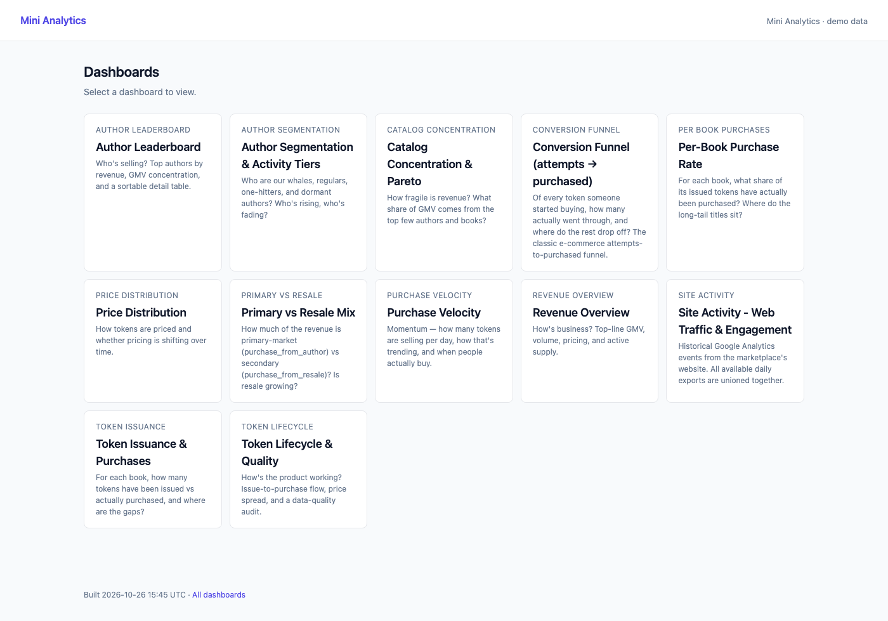

## Quick start

```bash
git clone https://github.com/gaiaengineer/mini-analytics.git
cd mini-analytics
python3 -m venv .venv && .venv/bin/pip install -e '.[dev]'

python3 scripts/make_demo_data.py          # fictional dataset → data/raw/
.venv/bin/mini-analytics build             # every dashboard → build/
open build/index.html
```

Requires Python 3.11+.

## How it works

```
 data/raw/*.csv            DuckDB (in memory)                   build/
 ───────────────           ───────────────────────────          ─────────────────────────
 authors                   source views  (typed CSV reads)      index.html
 books            ──►      model views   dim_author             <dashboard>/index.html
 tokens                                  dim_book        ──►    <dashboard>/exports/*.csv
 token_purchases                         fct_token_purchase
 ga_events/*.csv.gz        dashboard SQL (one YAML per page)
```

1. **Load.** Each CSV is registered as a typed DuckDB view, not copied. Daily Google Analytics files are unioned through a glob. Nothing is persisted, so every run starts clean.
2. **Model.** Three SQL views (`dim_author`, `dim_book`, `fct_token_purchase`) join and normalise the raw tables once, so dashboard queries stay short.
3. **Render.** Each block in a dashboard YAML runs its SQL and becomes a KPI tile, chart, table or note. Every chart and table also writes its result to a CSV.
4. **Fetch (optional).** `mini-analytics fetch` pulls the latest exports from S3 using the standard AWS credential chain; `build --refresh` fetches and builds in one step.

A dashboard is just YAML and SQL:

```yaml
id: revenue_overview
title: Revenue Overview
description: How's business? Top-line GMV, volume, pricing, and active supply.

blocks:
  - id: kpi_gmv_total
    type: kpi
    title: Total GMV
    format: currency
    sql: |
      SELECT COALESCE(SUM(price_cents), 0) / 100.0 AS value
      FROM fct_token_purchase
      WHERE is_purchased
```

Block types: `kpi`, `line`, `area_stacked`, `bar`, `histogram`, `scatter`, `table` and `note`. Adding a dashboard means dropping a new YAML file into `src/mini_analytics/dashboards/`, with no Python needed. The full format is in [docs/scripts.md](docs/scripts.md).

## The dashboards

Twelve pages, each answering one business question. Every metric is defined in plain English in [docs/dashboards.md](docs/dashboards.md).

### Revenue Overview
*How's business?* Total GMV, volume, average price, GMV by month and by sales channel, and a 30-day rolling average of daily purchases.

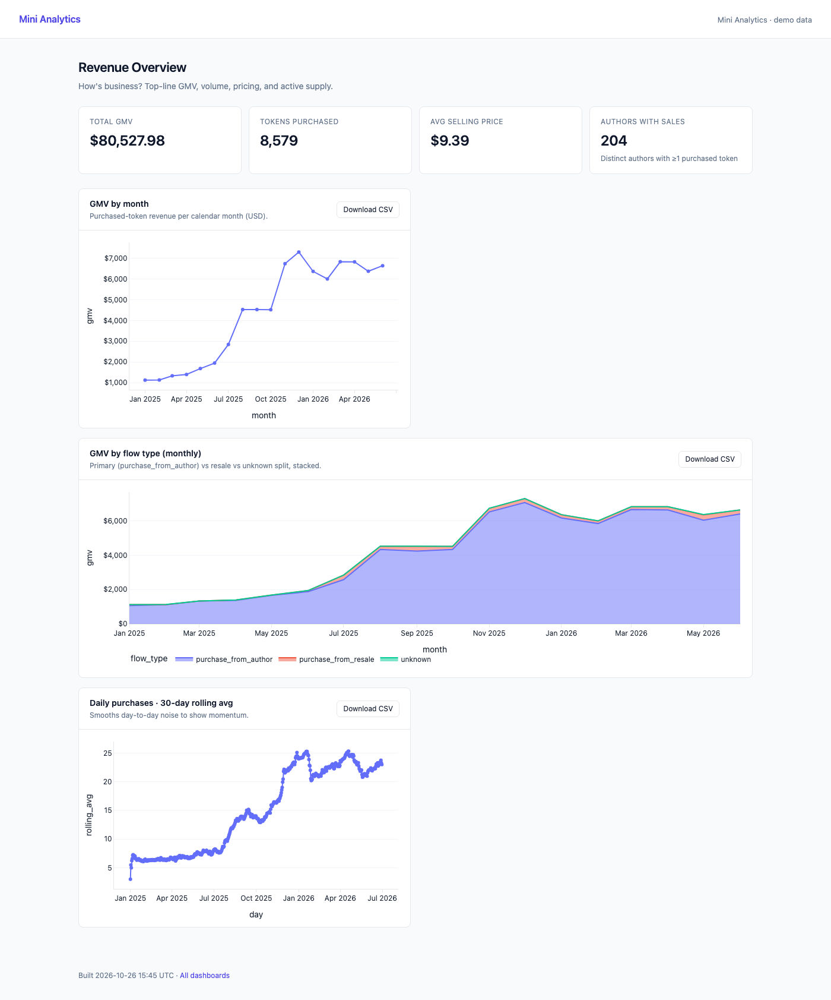

### Author Leaderboard
*Who's selling?* Top authors by revenue, how concentrated GMV is, and a sortable detail table.

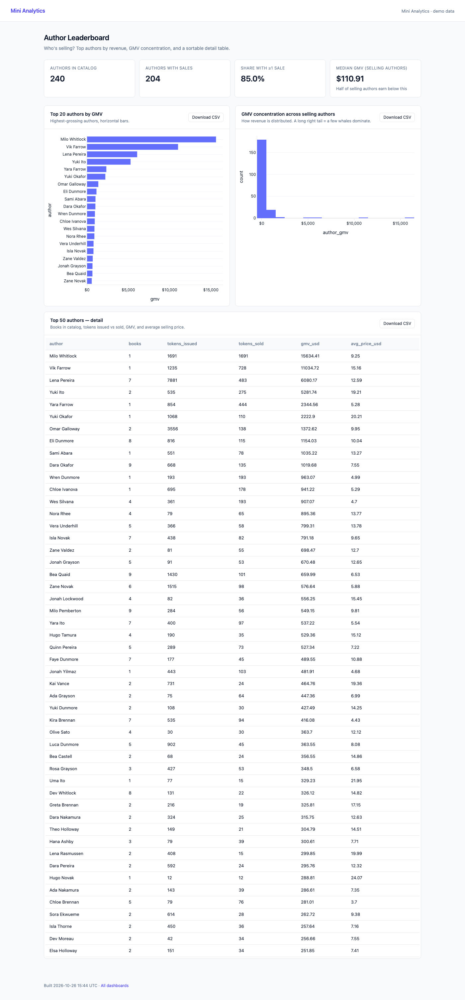

### Author Segmentation & Activity Tiers
*Who are the whales, regulars, one-hitters and dormant authors?* Tier rules applied in order, GMV share by tier over time, rising and falling authors, and days since last sale.

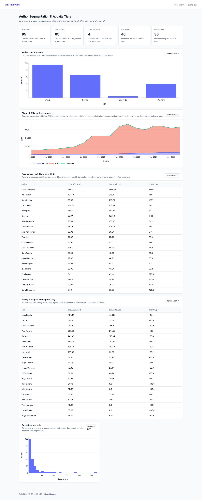

### Catalog Concentration & Pareto
*How fragile is revenue?* The share of GMV coming from the top authors and books, with Pareto curves.

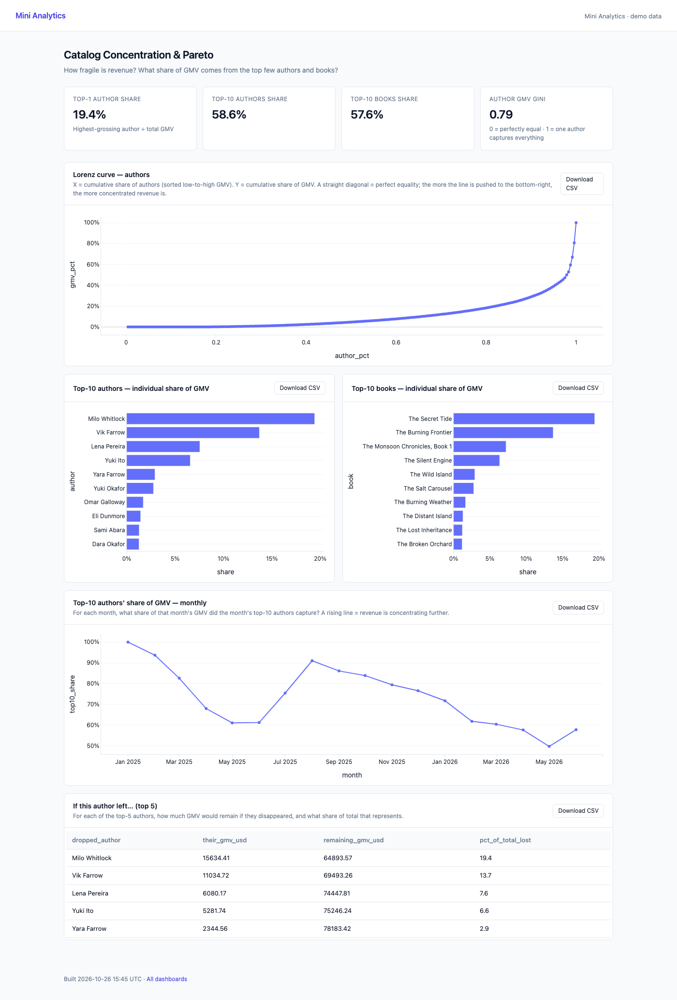

### Conversion Funnel
*Of every purchase someone started, how many went through, and where did the rest stop?*

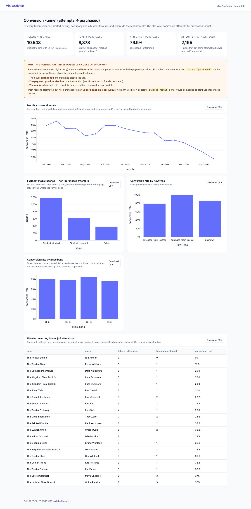

### Purchase Velocity
*How fast is it selling, and when do people buy?* Daily sales with trend, plus weekday and hour-of-day patterns.

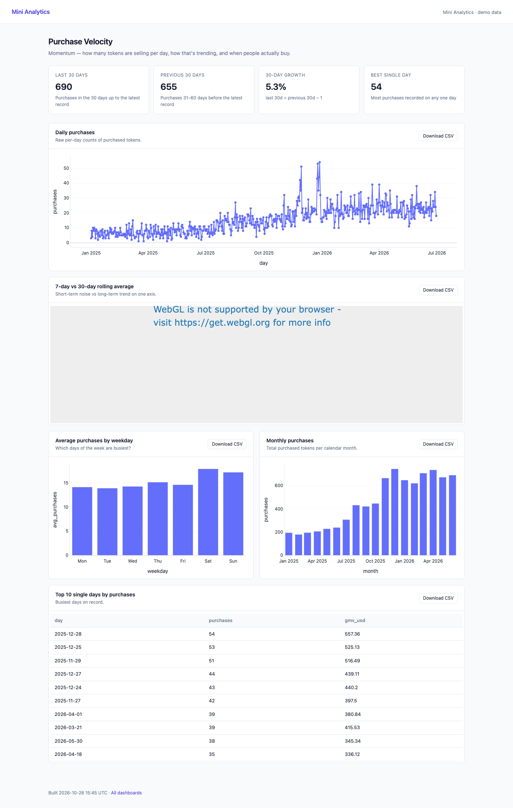

### Price Distribution
*How are copies priced, and is pricing shifting over time?*

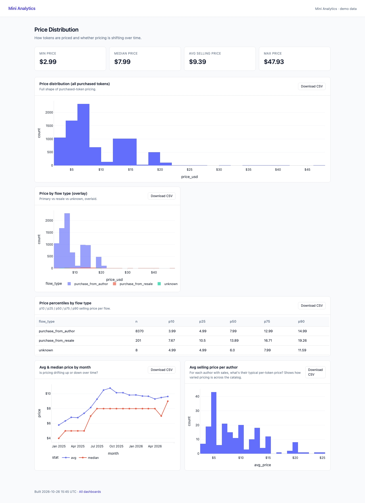

### Primary vs Resale Mix
*How much revenue comes from authors' own sales versus the secondary market, and is resale growing?*

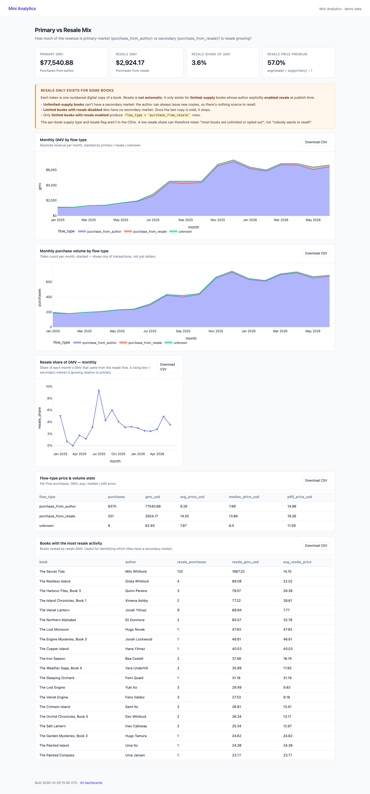

### Token Issuance & Purchases
*For each book, how many copies were issued versus bought?* A scatter of every book, purchase rate by issuance size, and triage lists for the largest gaps and the near-sold-out books.

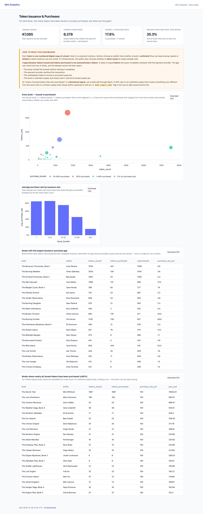

### Per-Book Purchase Rate
*Where do the long-tail titles sit?* The distribution of per-book purchase rates and the books at either end.

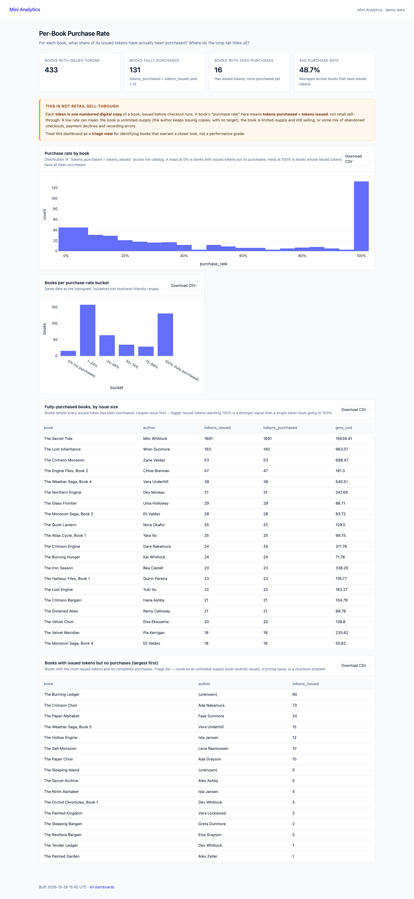

### Token Lifecycle & Quality
*Is the product working?* The issue-to-purchase funnel, price spread by channel, and a data-quality audit of purchases with a missing sales channel.

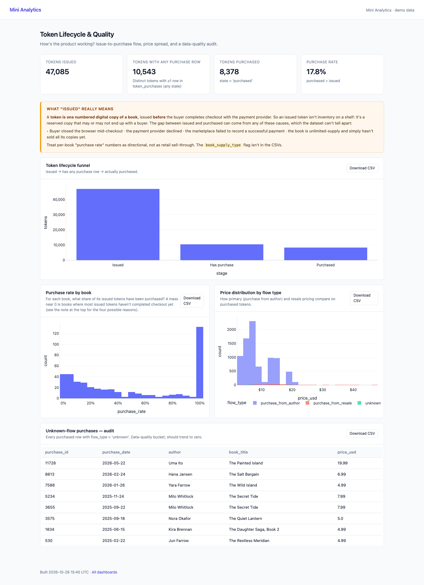

### Site Activity
*What happens on the website?* Google Analytics events, sessions and devices by day, weekday and hour; top pages; countries; and traffic sources.

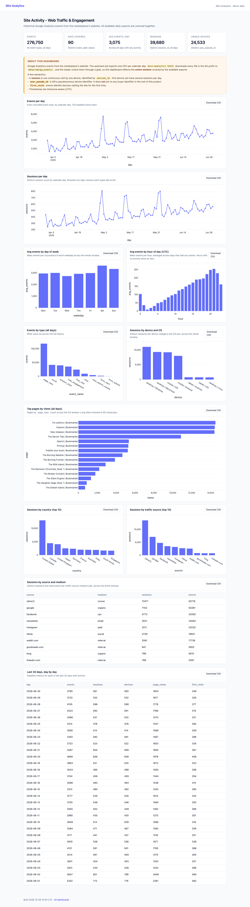

## Design choices

- **SQL first.** Every number on every page traces back to a query in a YAML file that anyone on the team can read and change. No hidden logic in Python.
- **Static output.** The build is a folder of HTML and CSV files: easy to host, easy to share, nothing to keep running.
- **Caveats on the page, not in someone's head.** Where the data can't support a confident reading (for example, unpaid copies could be abandoned checkouts, declined payments or recording errors), the dashboard says so in a visible note block.
- **Credentials never touch the repo.** S3 access uses the standard AWS chain; `sources.yml` only names the bucket and prefixes, and `.gitignore` blocks env and key files.
- **Tested.** 28 pytest tests cover the loader, the model views, the renderer and the S3 fetch (mocked with `moto`).

## Commands

| Command | Does |
|---|---|
| `mini-analytics ingest` | Loads the CSVs and prints row counts for every view |
| `mini-analytics tables` | Lists every view and its columns |
| `mini-analytics query "<sql>"` | Runs ad-hoc SQL against the views |
| `mini-analytics build [--refresh]` | Renders every dashboard into `build/` |
| `mini-analytics fetch` | Downloads the latest exports from S3 |

```bash
.venv/bin/pytest -q
```

## Documentation

- [docs/architecture.md](docs/architecture.md): data model, data flow and why it's built this way
- [docs/dashboards.md](docs/dashboards.md): every dashboard, block and metric, with definitions
- [docs/scripts.md](docs/scripts.md): CLI, `sources.yml`, the YAML format, adding a dashboard

## Author

Built by [Olga Alexeeva](https://olgaalexeeva.com) · [LinkedIn](https://www.linkedin.com/in/gaiaengineer)
